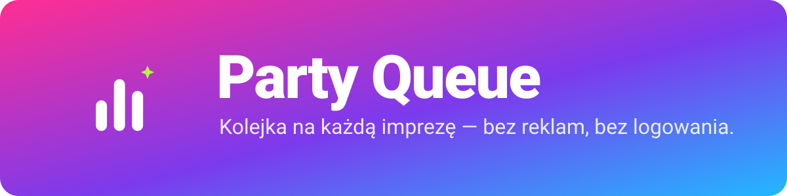

<h3 align="center">One phone. One queue. Everyone's songs. Jeden telefon. Jedna kolejka. Piosenki wszystkich.</h3>

<table>
<tr>
<td align="center" width="230">
 
<b>Scan to download Zeskanuj, aby pobrać</b> Android 10+, arm64
</td>
<td>

### 🇬🇧 Party Queue
An Android app that turns a phone into a **party jukebox**: it plays YouTube **without ads**, guests add songs from **their own phones or laptops**
through a web page – no accounts, nothing to install – and the host decides what plays next. A co-host can run it all from a laptop.

**[⬇ Download the APK](https://github.com/party-queue/party-queue/releases/latest/download/party-queue.apk)** ·
**[Website](https://party-queue.github.io/en/)** (all features, screenshots, install and update) ·
[Source](https://github.com/party-queue/party-queue)

### 🇵🇱 Party Queue
Aplikacja na Androida, która zamienia telefon w **imprezowy jukebox**: gra YouTube **bez reklam**, goście dodają piosenki **z własnych telefonów i laptopów**
przez stronę WWW – bez kont i bez instalowania – a gospodarz decyduje, co zagra dalej. Współhost może prowadzić wszystko z laptopa.

**[⬇ Pobierz APK](https://github.com/party-queue/party-queue/releases/latest/download/party-queue.apk)** ·
**[Strona projektu](https://party-queue.github.io/pl/)** (wszystkie funkcje, zrzuty ekranu, instalacja i aktualizacja) ·
[Kod źródłowy](https://github.com/party-queue/party-queue)
</td>
</tr>
</table>

## ☕ Free forever · Darmowa na zawsze

Party Queue is, and always will be, **completely free** – no ads, no paid features, no subscriptions, no accounts. If you like what I do, you can
**[buy me a coffee](https://suppi.pl/mleczakm)**. ·
Party Queue jest i zawsze będzie **w pełni darmowa** – bez reklam, płatnych funkcji, subskrypcji i kont. Jeśli podoba Ci się to, co robię, możesz
**[postawić mi kawę](https://suppi.pl/mleczakm)**.

## Repositories · Repozytoria

| | |
| --- | --- |
| [**party-queue**](https://github.com/party-queue/party-queue) | The Android app (Kotlin, Jetpack Compose, GeckoView) · aplikacja na Androida |
| [**party-queue.github.io**](https://github.com/party-queue/party-queue.github.io) | The website, English and Polish · strona projektu po angielsku i polsku → <https://party-queue.github.io> |

Free software ([AGPL-3.0](https://github.com/party-queue/party-queue/blob/main/LICENSE)). Not affiliated with YouTube, Google or Mozilla. ·
Wolne oprogramowanie. Niepowiązane z YouTube, Google ani Mozillą.
